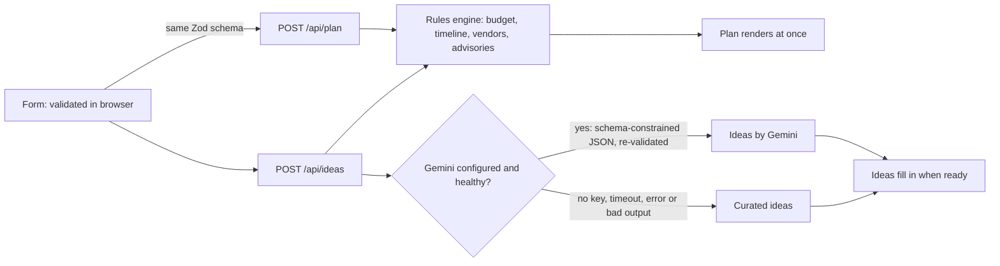

# Jashn: a GenAI celebration and event planner

Jashn (Hindi and Urdu for "celebration") turns a short description of a **wedding, birthday or community event** into a working plan: a budget that explains itself, a dated timeline that adapts to how much time is left, a vendor checklist with the questions to ask, and personalised ideas written by Gemini.

Challenge: **[Challenge 5] Celebration & Event Planner**.

## Chosen vertical and persona

The first-time organiser: a family member, friend or volunteer who has a date, a guest count and a fixed budget, but has never run an event of this size. They need decisions, not a blank checklist. They may be planning in India (where the sample data is set) or anywhere else; four currencies are supported.

## Approach and logic

The central design choice is a **deterministic planning engine with AI layered on top**, rather than asking a model to invent the whole plan.

| Concern | Who decides | Why |
| --- | --- | --- |
| Budget split, timeline dates, vendor list, risk flags | Pure TypeScript rules (`src/domain`) | Money and dates must be correct, repeatable, explainable and free to compute. |
| Themes, menu ideas, activities, decor and saving tips | Gemini, with a curated fallback | Creative and personal, so a language model is the right tool. |



### Logical decisions based on user context

Every adjustment is a small, readable rule, and the reason is shown to the user.

- **Budget.** Each event type has a default split. It is then adjusted for venue (a home venue cuts venue hire and raises rentals; outdoor raises logistics and the weather reserve), priorities (each gets a 30% larger weight), several dietary needs, children, and accessibility. The **contingency reserve grows** for outdoor events and for short notice. Amounts are whole units apportioned by the largest-remainder method, so the lines **always sum exactly to the budget** (property-tested on 400 random briefs).
- **Per-guest reality check.** The budget per guest is compared with a per-currency floor and labelled tight, balanced or generous, with a concrete suggestion when tight.
- **Timeline.** Milestones are defined as lead times before the event. With less time than the ideal horizon, long-lead tasks are **compressed proportionally**, final-fortnight tasks keep their place, and nothing is ever scheduled in the past. Steps due now are marked "Do now".
- **Vendors.** The checklist changes with context: no venue for a home party (rentals instead), shelter for outdoor events, a children's corner when children attend, and dietary and accessibility questions placed first for the caterer and venue. Book-by dates never fall before today.
- **Advisories.** Short-notice, large-gathering, crowded-home, weather and local-permission flags, ordered by severity.

## How it works

1. The user fills in the form (or loads one of three examples). The browser validates with the **same Zod schema as the server**, so rules cannot drift apart.
2. The browser calls `/api/plan` (instant) and `/api/ideas` (slower, optional) in parallel. The plan renders as soon as it arrives; ideas fill in later and can never block it.
3. The user can tick off vendors, download a **calendar (.ics) file** of every milestone, or print and save as PDF.

### Running it

```bash
npm ci
cp .env.example .env.local   # optional: add GEMINI_API_KEY for Gemini-written ideas
npm run dev                  # http://localhost:3000
npm run verify               # lint, typecheck, tests with coverage, production build
```

The app is **fully functional without an API key**: it then uses curated ideas and says so on screen. With a key, ideas are written by Gemini (`gemini-3.8-flash` by default, set with `GEMINI_MODEL`). Deploy to Vercel as-is, or build the included `Dockerfile` for Cloud Run.

### API

| Route | Purpose | Success | Errors |
| --- | --- | --- | --- |
| `POST /api/plan` | Deterministic plan | `200 { plan }` | `403` cross-site, `413` too large, `415` content type, `422` field errors, `429` with `Retry-After` |
| `POST /api/ideas` | Gemini or curated ideas | `200 { ideas: { source, ideas, notice? } }` | same as above |

## Assumptions

- Budgets are whole currency units; INR, USD, EUR and GBP are supported.
- Default budget splits and per-guest floors are **planning heuristics**, not market quotes. They live in one data table (`src/domain/profiles.ts`) so they are easy to review and change.
- The server clock is UTC; one day of slack avoids rejecting "today" for users west of UTC.
- Events can be planned up to three years ahead, for 2 to 2,000 guests.
- Local permission rules vary by place. The app reminds the user to check and does not give legal advice.
- No accounts and no database: plans live in the browser session only. This is deliberate for privacy and simplicity.

## How this maps to the evaluation criteria

| Criterion | Evidence |
| --- | --- |
| **Code quality** (high) | Strict TypeScript (`noUncheckedIndexedAccess`), pure domain layer with no I/O, dependency injection at every boundary (clock, limiter, AI generator), one source of truth for limits and schemas, small single-purpose modules, comments that explain why. ESLint with `jsx-a11y` runs clean. |
| **Security** (high) | See `SECURITY.md` for the threat model. Strict input schema, body-size cap, same-origin checks, rate limits, CSP with per-request nonce, prompt-injection containment, schema-validated model output, server-only secrets, generic errors, PII-free logs, 0 known vulnerabilities in `npm audit`. |
| **Efficiency** (medium) | Rule engine is O(n) and instant; AI is optional, runs in parallel, is bounded by a timeout, 1,500 output tokens and low thinking; no database; small client bundle with no UI framework beyond React. |
| **Testing** (low) | 146 tests, about 99% statement coverage of the logic layers: property tests for budget invariants, boundary tests for dates, failure-path tests for every AI failure mode, handler tests through real `Request` objects, and a full-stack UI flow test. |
| **Accessibility** (low) | Semantic landmarks and skip link, labelled controls with linked hints and errors, error summary that takes focus, focus moved to results, live status messages, native checkboxes and `details`, no colour-only meaning, reflow to 320 px, 44 px targets, reduced motion, forced colours, print styles. Colour contrast for every text pair in light and dark is **enforced by a test**, and `axe-core` runs on the UI in tests. |
| **Problem alignment** (high) | Covers all three event types with budgets, timelines, vendor checklists and personalised ideas, and makes the "logical decision making based on user context" visible through explained adjustments and advisories. |

## Project layout

```
src/domain   pure rules: schema, budget, timeline, vendors, advisories, ideas fallback, calendar
src/ai       prompt construction, Gemini adapter, orchestration with fallback
src/server   env, HTTP guards, rate limiter, request handlers, logging
src/app      Next.js pages, API routes, styles; src/proxy.ts sets CSP and security headers
src/components, src/lib   accessible UI and client helpers
tests        unit, property, handler, contrast and UI tests
```

## Limitations

- The in-memory rate limiter is per instance; use a shared store for a global cap.
- Budget splits are generic. Real quotes vary widely by city and season.
- The Gemini call is covered by unit tests against a mocked SDK; the live call needs your API key to exercise.
